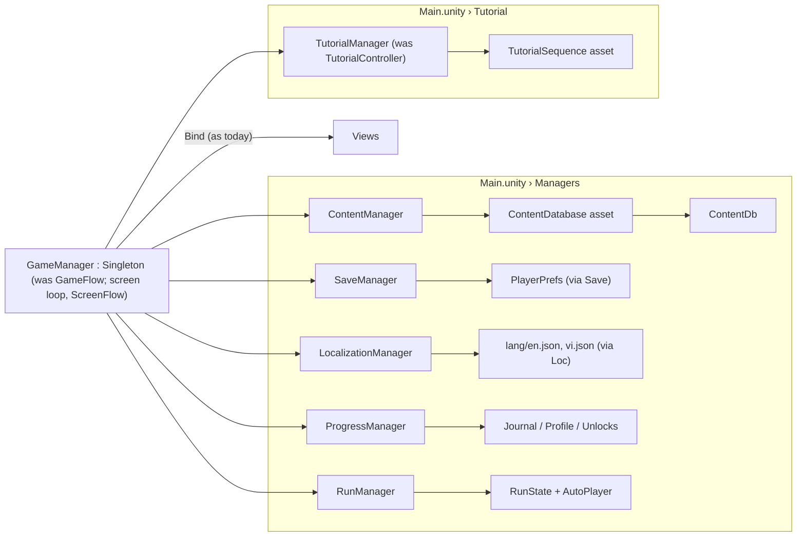

# ADR-0001: Unity managers, content assets and a data-driven tutorial

## Status
Accepted (owner, 2026-11-24; (a), (b) and (c) accepted as proposed: Unity tests on every PR, UL008 and CORE-PURITY retired, MIN_TESTS 600)

## Date
2026-11-24

## Last Verified
2026-11-24

## Decision Makers
The project owner (decides and accepts). Claude (author).

## Summary
Athanor's rules live in a plain C# assembly (`Athanor.Core`) that dotnet also compiles, content lives in `content.json`, and
`GameFlow` wires everything at run time, while the owner wants the project to work like a Unity template. Proposed (owner choices
of 2026-11-24): dotnet is retired so every test runs in Unity, managers in the scene drive plain rule models, content is one asset
per entry, the tutorial is a `TutorialSequence` asset and the balance reports are an Editor tool; the rest (the `Athanor.Gameplay`
assembly, five `Singleton<T>` managers on `Main.unity › Managers` plus `TutorialManager` on the `Tutorial` object and
`GameManager` as singletons, `snapshot.json`, the CI job) is the plan's proposal.

## Engine Compatibility
Unity 6000.6.7f1 (project.yaml). `docs/engine-reference/unity` is pinned to 6.3 LTS and predates this editor. The APIs this
change leans on (`RuntimeInitializeOnLoadMethod(SubsystemRegistration)`, `DefaultExecutionOrder`,
`Object.FindFirstObjectByType(FindObjectsInactive)`, `Application.logMessageReceived`, `SceneManager.LoadSceneAsync(Additive)`,
and Enter Play Mode Options with domain reload off) are checked against the 6000.6 manual in Task 2 Step 1, before the first
of them is used.

| Field | Value |
|-------|-------|
| **Engine** | Unity 6000.6.7f1 |
| **Domain** | Core (the Core layer this ADR removes) |
| **Layer** | Foundation |
| **Knowledge Risk** | HIGH |
| **References Consulted** | `docs/engine-reference/unity/VERSION.md` |
| **APIs to verify on 6000.6** | `RuntimeInitializeOnLoadMethod(SubsystemRegistration)`, `DefaultExecutionOrder`, `Object.FindFirstObjectByType(FindObjectsInactive)`, `Application.logMessageReceived`, `SceneManager.LoadSceneAsync(Additive)`, Enter Play Mode Options with domain reload disabled (`EditorSettings.enterPlayModeOptions`) |
| **Verification Required** | Task 2 Step 1 of `docs/superpowers/plans/2026-11-24-unity-template-refactor.md` (before Tasks 2-3 use them) |

Layer is Foundation because this ADR replaces the rules assembly, the content data and the scene's manager composition, and wraps
save/load in `SaveManager` (storage unchanged); everything else depends on these. Knowledge Risk is HIGH because
`docs/engine-reference/unity/VERSION.md` rates 6.3 LTS HIGH, the model cutoff is May 2025, and the editor is past the pin.

## ADR Dependencies
None (first ADR). Supersedes lines of `docs/ATHANOR.md` §4 listed under Consequences.

| Field | Value |
|-------|-------|
| **Depends On** | None |
| **Enables** | None |
| **Blocks** | Every task after Task 0 in `docs/superpowers/plans/2026-11-24-unity-template-refactor.md` (nothing starts while this ADR is Proposed) |
| **Ordering Note** | Do not run `docs/superpowers/plans/2026-11-23-depth-scaling-progression.md` alongside this plan |

## Context
Athanor's rules live in `Athanor.Core`, a plain C# assembly with no UnityEngine that is also compiled by dotnet
(`tools/CoreTests`, `tools/CoreReports`). Content is `Resources/content.json`. `GameFlow` builds and wires everything at run time.
The owner wants the project to work like a Unity template: managers in the scene, data as assets edited in the Inspector,
and gameplay checked in Play Mode.

## Decision
1. `Athanor.Core` becomes the Unity assembly `Athanor.Gameplay`. The rule models stay plain C# classes inside it.
2. Five `Singleton<T>` managers on the `Managers` object of `Main.unity` own content, saves, language, progress and the run:
   `ContentManager`, `SaveManager`, `LocalizationManager`, `ProgressManager`, `RunManager`. `TutorialManager` (the renamed
   `TutorialController`) stays on the `Tutorial` object, and `GameFlow` is renamed `GameManager`; both become singletons too, and
   `GameManager` keeps the screen loop. Each singleton is cleared at `SubsystemRegistration`, because domain reload is off.
3. Content is one ScriptableObject asset per entry under `Assets/Content`, listed by `ContentDatabase`. The rules still read the
   plain `ContentData` shape, built by `ContentDatabase.ToContentData()`. `content.json` is deleted. Tools outside Unity read
   `tools/content/snapshot.json`, which the Editor writes; `ContentSnapshotTests` fails when it is stale.
4. The tutorial is a `TutorialSequence` asset: steps, lit areas, scripted trials and the lesson order.
5. dotnet is retired. Every test runs in Unity (EditMode + PlayMode). The balance reports are an Editor tool with a batch entry.
   CI runs Unity tests through game-ci, which needs the `UNITY_LICENSE`, `UNITY_EMAIL` and `UNITY_PASSWORD` secrets on every PR
   (pending the owner's confirmation (a) below).

The owner chose on 2026-11-24: retiring dotnet, managers in the scene with plain rule models, one asset per entry, the
`TutorialSequence` asset and the balance reports as an Editor tool. The rest of this decision is the plan's proposal.

### Owner to confirm on acceptance
- (a) Unity tests run on every PR, replacing today's tags-only policy for Unity. Cost: a licence activation per PR, jobs of up to
  90 minutes, GitHub Actions minutes, and no secrets on PRs from forks.
- (b) Retire UL008 and CORE-PURITY, or narrow them to the rule-model files (`Scripts/Gameplay` except `Content/`).
- (c) A `MIN_TESTS` guard of 600 on `unity-tests`.

### Architecture Diagram



Execution order (`DefaultExecutionOrder`):

| Component | Object | Order |
|-----------|--------|-------|
| ContentManager | Managers | -200 |
| SaveManager | Managers | -190 |
| LocalizationManager | Managers | -180 |
| ProgressManager | Managers | -170 |
| RunManager | Managers | -160 |
| TutorialManager | Tutorial | -150 |
| GameManager | Game (as `GameFlow` today) | default |

### Key Interfaces
Signatures only, as given in the plan (Tasks 10, 14, 16-18 and 20).

```csharp
public static class Singletons
{
    [RuntimeInitializeOnLoadMethod(RuntimeInitializeLoadType.SubsystemRegistration)]
    public static void ResetStatics();
}

public abstract class Singleton<T> : MonoBehaviour where T : Singleton<T>
{
    // Throws when the manager is missing: not in the scene, before that manager's Awake has run,
    // or after it is destroyed (hence the execution order).
    public static T Instance { get; }
    public static bool Exists { get; }
    protected virtual void OnAwake();
    protected virtual void OnDestroy();
}

public sealed class ContentDatabase : ScriptableObject
{
    public GameRules rules;
    public List<MaterialDefinition> materials;
    public List<RecipeDefinition> recipes;
    public List<CatalystDefinition> catalysts;
    public List<AspectDefinition> aspects;
    public List<EventDefinition> events;
    public List<GoalDefinition> goals;
    public ContentData ToContentData();
}

// ContentManager (Managers, -200)
public ContentDatabase Database { get; }
public ContentDb Db { get; }

// SaveManager (Managers, -190)
public Settings Settings { get; }
public void StoreSettings();
public bool IntroSeen { get; }
public void SetIntroSeen(bool seen);
public bool TutorialDone { get; }
public void SetTutorialDone(bool done);

// LocalizationManager (Managers, -180): no public members; publishes the language files through Loc.
public sealed class LocalizationManager : Singleton<LocalizationManager>

// ProgressManager (Managers, -170)
public Journal Journal { get; }
public Profile Profile { get; }
public Unlocks RunUnlocks { get; }
public bool Sandbox { get; }
public Unlocks RefreshUnlocks();
public void StoreJournal();
public void StoreProfile();
public List<GoalReward> EvaluateGoals();
public void BeginSandbox();
public void EndSandbox();
public void ResetProgress();
public void ReloadAfterQuit();
public static Journal JournalAfterQuit(bool sandbox, Journal current);
public static Profile ProfileAfterQuit(bool sandbox, Profile current, ContentDb db);

// RunManager (Managers, -160)
public RunState Run { get; }
public AutoPlayer AutoPlayer { get; }
public int LastSeed { get; }
public int SeedOverride { get; set; }
public int NextSeed();
public RunState Begin(RunOptions options, int seed);
public IgniteOutcome Settle();

// TutorialManager (Tutorial object, -150; was TutorialController, same GUID)
public sealed class TutorialManager : Singleton<TutorialManager>
public TutorialSequence Sequence { get; }
public TutorialStepDef Step(string id);

// GameManager (was GameFlow; keeps the screen loop)
public sealed class GameManager : Singleton<GameManager>

public sealed class TutorialSequence : ScriptableObject
{
    public int seed;
    public int quietBefore;
    public CatalystDefinition[] firstOffer;
    public TutorialTrialDef[] trials;
    public CatalystTrialDef[] catalystTrials;
    public string[] offerLines;
    public string offerHold;
    public List<TutorialStepDef> steps;    // each TutorialStepDef holds List<TutorialAreaDef> areas
    public List<TutorialAction> script;
    public TutorialStepDef Step(string id);
    public TutorialTrial Trial(int i);
    public TutorialTrial CatalystTrial(string catalystId);
    public string[] FirstOfferIds();
    public RunOptions Options(Unlocks unlocks);
}
```

### Implementation Guidelines
- Rule models must never call Unity APIs. The rule models are `Scripts/Gameplay/*.cs` except `Content/` (`RunState`, `RunStart`,
  `IgniteResolver`/`Ignite`, `ChainPlanner`/`Chain`, `BenchRules`, `Satchel`, `Journal`, `Profile`, `ScreenFlow`, `AutoPlayer`,
  `ContentDb`, `ContentData`, …). Only review enforces this once UL008 is retired, unless (b) keeps a narrowed UL008.
- Derived managers must put start-up in `OnAwake`, must never declare `Awake`, and must call `base.OnDestroy()` when they override
  `OnDestroy`.
- `LocalizationManager` has no public members; it publishes through `Loc`. `TutorialManager` exposes `Sequence` and `Step(id)`.
- Singletons must never be created lazily, and must never use `DontDestroyOnLoad`.
- Scene and prefab changes must go through Editor scripts or the Editor; `.unity` and `.prefab` files must never be edited as text.
- Moving a script must move its `.meta` file so the GUID is kept.
- A renamed serialized field must carry `[FormerlySerializedAs]`.
- Content entries keep their string ids; saves keep string ids.
- `ContentSnapshotTests` fails when `tools/content/snapshot.json` is stale; regenerate it with Athanor > Content > Write Snapshot.

## Alternatives Considered
- Rewrite the rules as MonoBehaviours: rejected by the owner (slow seeded tests, 200-seed balance runs in a scene, high risk of drift).
- Keep the pure Core and add manager facades only: rejected (it does not remove the Core layer).
- One big content asset of [Serializable] arrays: rejected (hard to edit one entry, merge conflicts on one file).

## Consequences
- Narrows the 2026-11-11 clause "rules in plain C# with content as data": rule models stay plain C#, now in a Unity assembly, and
  content stays data, now held in assets. Supersedes the 2026-11-19 clause `rule numbers live in content.json "rules"` (rule numbers
  move to `Assets/Content/GameRules.asset`), the 2026-11-18 clause on `tools/CoreReports`, the 2026-11-19 clause that the scripted
  hands stay in Core `TutorialScript`, and, from Task 24, the 2026-11-20 `TutorialStep` line. Amends the names in the 2026-11-19
  Phase 7 line (`GameFlow`, Core `ScreenFlow`).
- Retires UL008 and CORE-PURITY (or narrows them to `Scripts/Gameplay` except `Content/`, per (b)), the dotnet `core-tests` job and
  the `MIN_TESTS` guard on dotnet. The new `unity-tests` job has a `MIN_TESTS` guard of 600 (per (c)).
- CI needs a Unity licence on every PR (pending (a)). Until the secrets exist, `unity-tests` fails on purpose, so `ci-gate` is red.
- Content diffs are now Unity YAML rather than one JSON file. `snapshot.json` keeps a readable diff in reviews.
- Rule models must not call Unity APIs; only review enforces this once UL008 is retired (unless (b) keeps a narrowed UL008).

## Risks
- Behaviour drift during the move. Mitigation: byte-identical balance reports, golden shots, the tutorial lit baseline and seeded
  PlayMode traces, all recorded before any change.
- CI is red until the Unity secrets exist. Mitigation: `tools/ci/run.sh unity` runs the same suites locally; the owner adds the
  secrets at Task 8 Step 8. Until then no PR can merge (`ci-gate` is the only required check).
- Statics survive Stop/Play with domain reload off. Mitigation: `Singletons.ResetStatics` at `SubsystemRegistration`,
  `SingletonTests`, the Task 19 second-session PlayMode test, and the owner's Play/Stop/Play check.
- Scene or prefab references are lost when a script is renamed. Mitigation: each script moves with `git mv` of its `.meta` (GUID
  kept), and Task 15 Step 3 checks there is no diff under Scenes/ or Prefabs/.
- Imported content assets differ from `content.json`. Mitigation: the Task 11 equivalence test.
- `snapshot.json` goes stale. Mitigation: `ContentSnapshotTests`.
- Report output changes when the reports move from dotnet to the Editor. Mitigation: InvariantCulture formatting and a byte diff
  against the baseline (Task 7).
- Unity calls creep into rule models once UL008 and CORE-PURITY retire. Mitigation: review only; no automated check remains, unless (b) keeps a narrowed UL008.
- Merge conflicts on content assets. Mitigation: one asset per entry, plus `snapshot.json` for a readable diff.
- An API change in Unity 6000.6 versus the 6.3 reference. Mitigation: Task 2 Step 1 checks `RuntimeInitializeOnLoadMethod(SubsystemRegistration)`, `DefaultExecutionOrder`, `Object.FindFirstObjectByType(FindObjectsInactive)`, `Application.logMessageReceived`, `SceneManager.LoadSceneAsync(Additive)`, Enter Play Mode Options with domain reload disabled (`EditorSettings.enterPlayModeOptions`)
  against the 6000.6 manual before the first of them is used.

## GDD Requirements Addressed
None: a structure change. No rule, number or player-visible text is intended to change (checked by golden shots, byte-identical
reports and PlayMode traces).

Foundational — no GDD requirement. Enables: none.

## Performance Implications
- **CPU**: No change expected. Content is validated once at start-up, as today.
- **Memory**: No measurement in the plan; not expected to change.
- **Load Time**: Not measured; expected unchanged, since the database is still built and validated once in `ContentManager.OnAwake`.
- **Network (web build size)**: Budget 11,824,672 B (the 2026-11-15 Phase 5 ceiling); last measured 10,919,503 B. Managers and
  assets are expected to add a few KB. `Sim` stays out of the build (it moves from a test assembly to an Editor-only one).

## Migration Plan
Follows the stages of `docs/superpowers/plans/2026-11-24-unity-template-refactor.md`:

0. Decision and safety net: this ADR, the baselines and the PlayMode traces.
1. `Athanor.Core` becomes `Athanor.Gameplay`; the unused `Scripts/Data` prototype is deleted.
2. dotnet retired.
3. Content as ScriptableObject assets.
4. Manager singletons.
5. Tutorial as data.
6. Control in the Inspector.
7. Documents and the final gate.

**Rollback plan**: Before merge: drop the branch, or reset to the Task 3 checkpoint to keep the safety net (the Task 1-3
baselines describe the old game, so the old build can be re-checked against them). After merge: revert the merge commit (or the
squash commit). On either path, restore the `docs/ATHANOR.md` §4 lines this ADR changed and set Status to Rejected. Saves keep string ids and the same PlayerPrefs keys (`Save` is unchanged), so a save written by the
new build loads in the old one.

## Validation Criteria
No rule, number or player-visible text is intended to change; this is checked by:
- The six balance reports are byte-identical to the recorded baseline.
- `GoldenShotTests` show 0 % difference.
- `tutorial_lit_baseline.json` still matches.
- The seeded autoplay and tutorial PlayMode traces are identical.
- The web build is under budget with 0 console errors.

The structure change itself is checked by:
- `unity-tests` passes with at least 600 tests.
- The Task 19 second-session PlayMode test passes.
- The owner's Play/Stop/Play check in the Editor shows no stale managers.

## Related
- Plan: `docs/superpowers/plans/2026-11-24-unity-template-refactor.md` (Task 0).
- Narrows, supersedes and amends lines of `docs/ATHANOR.md` §4, as listed under Consequences.
