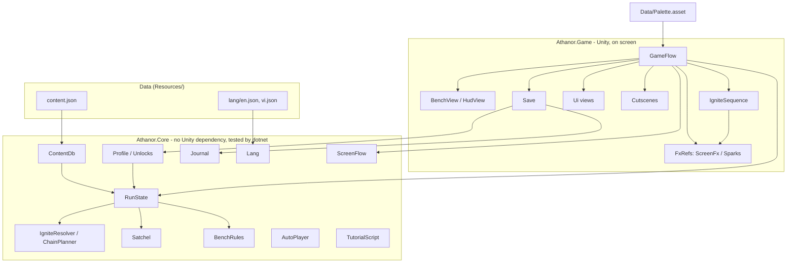

# Architecture

| Layer | Path | Rule |
|---|---|---|
| Core | `Athanor/Assets/Scripts/Core` ([[Core Index]]) | Deterministic (seeded [[Rng]]), no `UnityEngine`, compiled by `tools/CoreTests` too |
| Game | `Athanor/Assets/Scripts/Game` ([[Game Index]]) | All rendering, input, tweens (PrimeTween), cutscenes; composition root and bridge in [[GameFlow]]; the screen state machine is Core [[ScreenFlow]] |
| Editor | `Athanor/Assets/Editor` ([[Editor Index]]) | Scene/font/atlas/web-build tools; menu **Athanor** |
| Tests | `Athanor/Assets/Tests`, `tools/CoreTests` ([[Tests Index]]) | Rule tests run without Unity |
| Tools | `tools/` ([[Tools Index]]) | Sprite generation (`art`), effect sheets (`fx`), headless web checks (`web`), this vault (`vault`) |

## Run lifecycle
`RunPhase` ([[RunPhase]]): Playing → (DepthCleared → AspectOffer / EventOffer → Playing) → Won | Lost. The screen-level state machine is [[ScreenFlow]] (Core; [[GameFlow]] drives it) over [[FlowState]]: Boot, Title, Intro, Bench, Resolving, Journal, Descent, CatalystChoice, AspectChoice, Event, Goals, Ending, RunOver.

## Conventions that matter
- Game-layer code never decides rules: it asks Core. New rule → Core + test first.
- Anything the player reads goes through [[Lang]] keys (`lang/*.json`), except content names/texts which live in `content.json` (see [[Data Design]]).
- Pixel art is laid out on a 640x360 canvas ([[Px]]). `Main.unity` and the prefabs hold the positions, sizes, colours and timings of the views and sequences that were moved (what stays in code is listed in `docs/ATHANOR.md` section 7 item 11(e)): a fixed position is a prefab Transform, a layout or timing number is a serialized `Layout` / `Timing` struct on the view that uses it, a colour shared by two files is in [[Palette]], rule numbers are `rules` in `content.json` ([[RulesData]]). No code defaults; `LayoutPinTests` pin the values. `layout.json` is read by editor tooling only ([[LayoutData]]).
- Effects are passed, not found: [[FxRefs]] goes through `Bind` to each view; [[IgniteSequence]] plays one Ignite's choreography.
- Game-layer statics only in the lint allowlist (`Loc`, `PointerInput`, `Art`, `Haptics`, `AudioMute`, `SparkMesh`, `TiltShift`, `RarityStars`), each reset at SubsystemRegistration. WebGL is single-threaded: no `Task.Run`, `Thread`, `.Result`, `.Wait()`; platform `#if` only in the bridge files. Details: `docs/ATHANOR.md` section 2.
- A new material/catalyst/aspect needs an icon with the same id in `tools/art/icons.mjs`.
