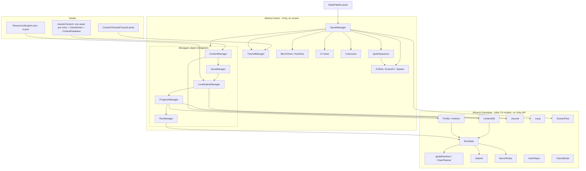

# Architecture

| Layer | Path | Rule |
|---|---|---|
| Gameplay | `Athanor/Assets/Scripts/Gameplay` ([[Gameplay Index]]) | Deterministic (seeded [[Rng]]) plain C# models in the Unity assembly `Athanor.Gameplay`; no Unity API (review only; UL008 has no path) |
| Game | `Athanor/Assets/Scripts/Game` ([[Game Index]]) | `Managers` ([[ContentManager]], [[SaveManager]], [[LocalizationManager]], [[ProgressManager]], [[RunManager]]), `Tutorial` ([[TutorialManager]], [[TutorialSequence]]), rendering, input, tweens (PrimeTween), cutscenes; the screen loop is [[GameManager]] over Gameplay [[ScreenFlow]] |
| Editor | `Athanor/Assets/Editor` ([[Editor Index]]) | Scene/font/atlas/web-build tools, content inspectors, [[BalanceReports]] (menu **Athanor > Balance**), `ContentSnapshot`; menu **Athanor** |
| Tests | `Athanor/Assets/Tests`: EditMode, EditModeGame, PlayMode ([[Tests Index]]) | Every test runs in Unity (`unity test Athanor --mode EditMode` / `PlayMode`); no dotnet project |
| Tools | `tools/` ([[Tools Index]]) | Sprite generation (`art`), effect sheets (`fx`), headless web checks (`web`), `content/snapshot.json`, this vault (`vault`) |

## Run lifecycle
`RunPhase` ([[RunPhase]]): Playing → (DepthCleared → AspectOffer / EventOffer → Playing) → Won | Lost. The screen-level state machine is [[ScreenFlow]] (Gameplay; [[GameManager]] drives it) over [[FlowState]]: Boot, Title, Intro, Bench, Resolving, Journal, Descent, CatalystChoice, AspectChoice, Event, Goals, Ending, RunOver.

## Conventions that matter
- Views and managers never decide rules: they ask the Gameplay models. New rule → Gameplay model + test first.
- Anything the player reads goes through [[Lang]] keys (`lang/*.json`), except content names/texts which live in the content assets (see [[Data Design]]).
- Pixel art is laid out on a 640x360 canvas ([[Px]]). `Main.unity` and the prefabs hold the positions, sizes, colours and timings of the views and sequences that were moved (what stays in code is listed in `docs/ATHANOR.md` section 7 item 11(e)): a fixed position is a prefab Transform, a layout or timing number is a serialized `Layout` / `Timing` struct on the view that uses it, a colour shared by two files is in [[Palette]], rule numbers are the [[GameRules]] asset ([[RulesData]]). No code defaults; `LayoutPinTests` pin the values. `layout.json` is read by editor tooling only ([[LayoutData]]).
- Effects are passed, not found: [[FxRefs]] goes through `Bind` to each view; [[IgniteSequence]] plays one Ignite's choreography.
- Game-layer statics only in nine classes (`Loc`, `PointerInput`, `Art`, `Haptics`, `AudioMute`, `SparkMesh`, `TiltShift`, `RarityStars`, `Singletons`), each reset at SubsystemRegistration (`StaticResetTests`; a review rule, not lint). WebGL is single-threaded: no `Task.Run`, `Thread`, `.Result`, `.Wait()`; platform `#if` only in the bridge files. Details: `docs/ATHANOR.md` section 2.
- A new material/catalyst/aspect needs an icon with the same id in `tools/art/icons.mjs`.
