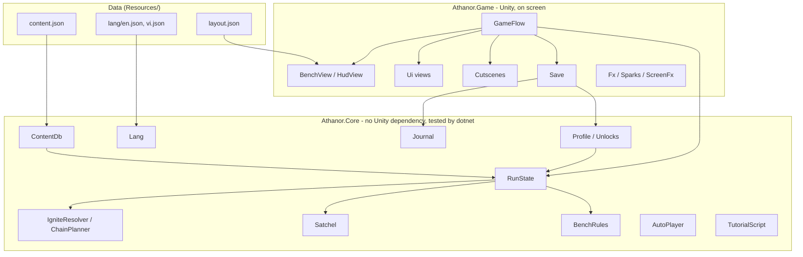

# Architecture

| Layer | Path | Rule |
|---|---|---|
| Core | `Athanor/Assets/Scripts/Core` ([[Core Index]]) | Deterministic (seeded [[Rng]]), no `UnityEngine`, compiled by `tools/CoreTests` too |
| Game | `Athanor/Assets/Scripts/Game` ([[Game Index]]) | All rendering, input, tweens (PrimeTween), cutscenes; owns the screen state machine in [[GameFlow]] |
| Editor | `Athanor/Assets/Editor` ([[Editor Index]]) | Scene/font/atlas/web-build tools; menu **Athanor** |
| Tests | `Athanor/Assets/Tests`, `tools/CoreTests` ([[Tests Index]]) | Rule tests run without Unity |
| Tools | `tools/` ([[Tools Index]]) | Sprite generation (`art`), effect sheets (`fx`), headless web checks (`web`), this vault (`vault`) |

## Run lifecycle
`RunPhase` ([[RunPhase]]): Playing → (DepthCleared → AspectOffer / EventOffer → Playing) → Won | Lost. The screen-level state machine is [[FlowState]] in [[GameFlow]]: Boot, Title, Intro, Bench, Resolving, Journal, Descent, CatalystChoice, AspectChoice, Event, Goals, Ending, RunOver.

## Conventions that matter
- Game-layer code never decides rules: it asks Core. New rule → Core + test first.
- Anything the player reads goes through [[Lang]] keys (`lang/*.json`), except content names/texts which live in `content.json` (see [[Data Design]]).
- Pixel art is laid out on a 640x360 canvas ([[Px]]); positions come from `layout.json` ([[LayoutData]]).
- A new material/catalyst/aspect needs an icon with the same id in `tools/art/icons.mjs`.
