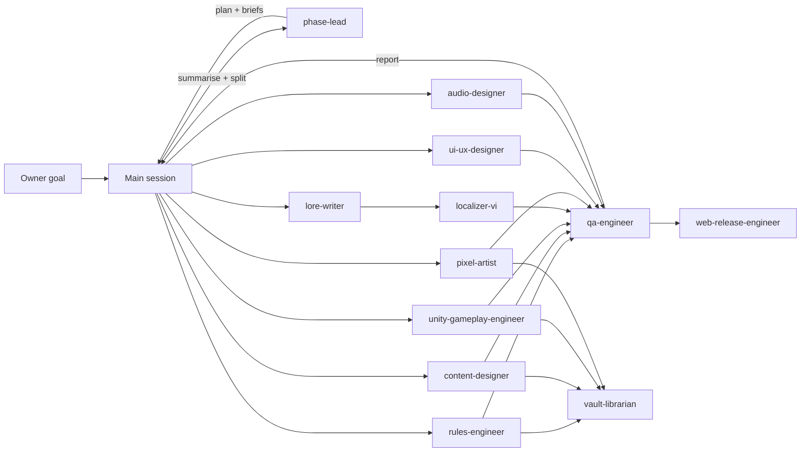

# Agent Workflow

From **Phase 5** the project runs as: **summarise → split → dispatch → verify → integrate**.

## Roles (project agents live in `.claude/agents/`, see [[Agents Index]])
| Agent | Owns | Typical task |
|---|---|---|
| [[agent.phase-lead]] | plans, briefs | summarise the phase, write briefs |
| [[agent.rules-engineer]] | `Scripts/Core`, EditMode tests | new effect, scoring or chain rule |
| [[agent.unity-gameplay-engineer]] | `Scripts/Game`, `Editor` | screen, view, flow state, save plumbing |
| [[agent.content-designer]] | `content.json` | recipes, events, goals, balance |
| [[agent.lore-writer]] | story text, lore canon (ATHANOR.md §8) | cutscene lines, Lore events |
| [[agent.localizer-vi]] | `lang/vi.json`, glossary | translation, key parity |
| [[agent.pixel-artist]] | `tools/art`, `tools/fx` | icons, sprites, effect sheets |
| [[agent.ui-ux-designer]] | `Editor/layout.json`, prefab layout | screen layout specs |
| [[agent.audio-designer]] | `design/audio` | cue list, assets (when sound is in scope) |
| [[agent.qa-engineer]] | tests, `production/qa` | sign-off, balance reports, bug repro |
| [[agent.web-release-engineer]] | `WebBuild`, `tools/web` | build, size, release notes |
| [[agent.vault-librarian]] | `vault/` | regenerate, fix links, answer structure queries |

The inherited CCGS agents (creative-director, technical-director, producer, lead-programmer, qa-lead…) remain as **review/gate consultants** used by the framework skills (`/gate-check`, `/design-review`, `/code-review`, `/team-*`). Implementation goes to the Athanor roles above.

## A phase, step by step
1. **Summarise** — main session runs `phase-lead` (or does it inline for small phases): state of the project from [[Phases]], `docs/ATHANOR.md` §4 and §7, `git status`, [[Content Health]].
2. **Decide** — open owner questions are listed with a recommendation; the owner answers. No task starts on an undecided design question.
3. **Split** — `phase-lead` writes the plan to `production/plans/` with one brief per task: agent, objective, inputs, acceptance command, out-of-scope, depends-on.
4. **Dispatch** — main session launches independent briefs in parallel (disjoint files only), sequential ones in order. Content and rules first, art/UI next, QA last.
5. **Verify** — `qa-engineer` runs the checklist; a failing item returns to its owner as a new brief.
6. **Integrate** — main session reviews the diff, `vault-librarian` regenerates the vault, `docs/ATHANOR.md` §4 gets a line for any decision; the owner decides on commit.

## Hand-off rules
- An agent that needs a file it does not own writes it under *Handoffs* instead of editing it.
- Agents cannot ask the owner; they return *Open questions*. The main session asks.
- Two agents never edit the same file in one wave. If a brief set overlaps, serialise it.
- Briefs cite vault notes and `file:line` so the agent starts warm. See [[Vault Guide]].
